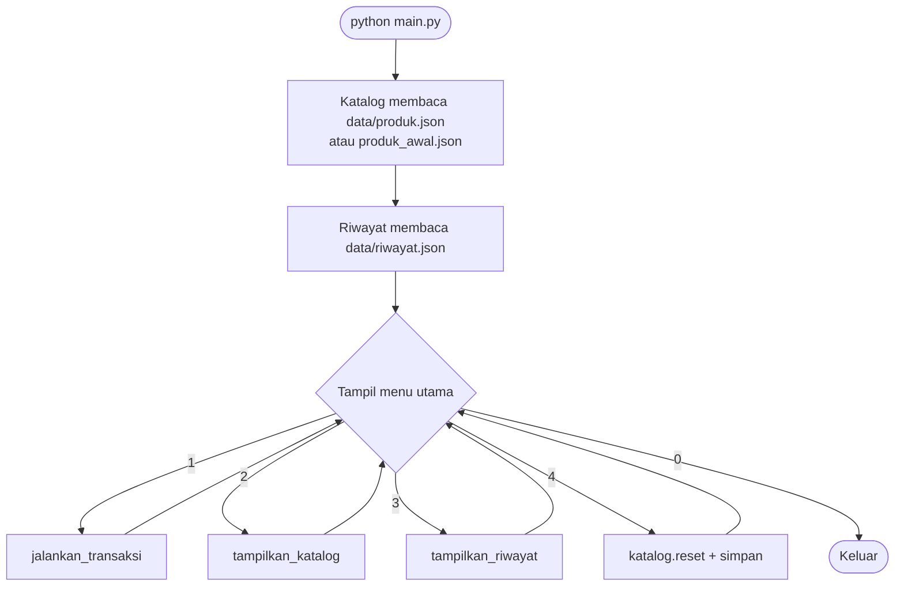
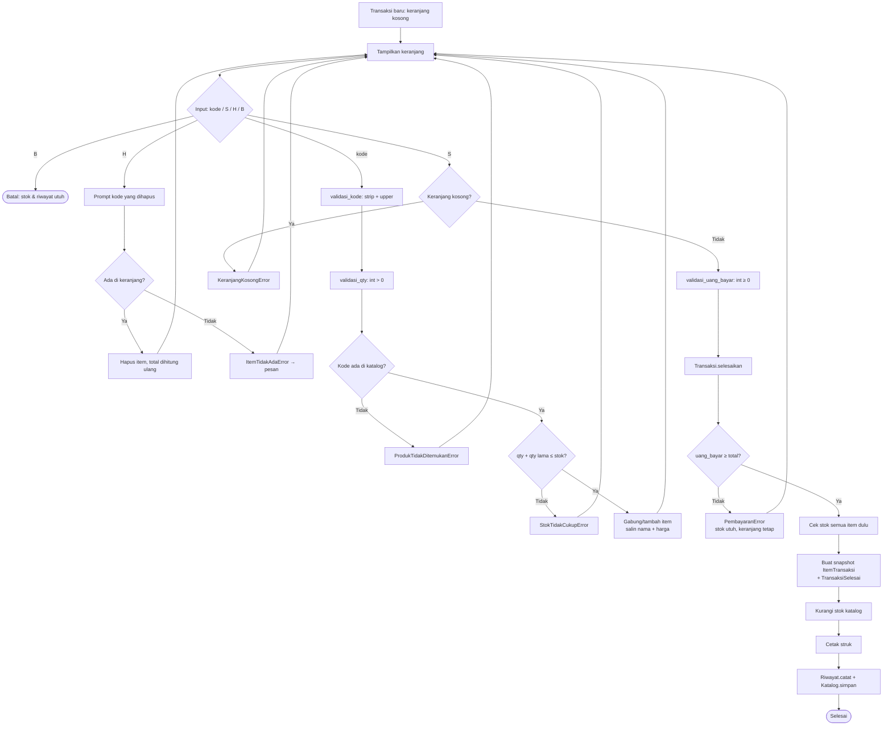
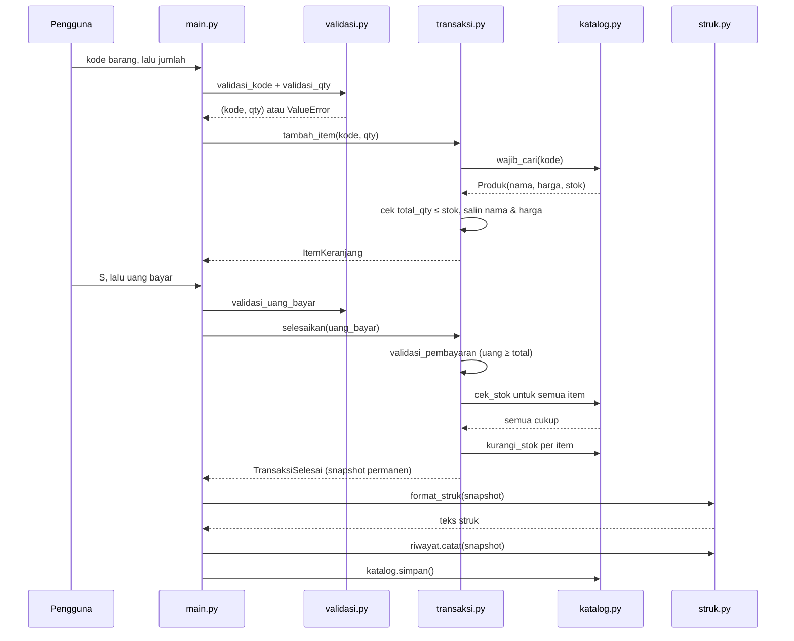

# Aplikasi Kasir (POS) CLI — Dokumentasi Lengkap

Aplikasi kasir berbasis command-line menggunakan **Python 3**, tanpa dependency pihak ketiga. Seluruh logika bisnis berada di package `pos/`, sedangkan `main.py` hanya mengurusi interaksi `input()`/`print()`.

- **Versi:** 0.2.0
- **Python:** 3.10+ (dikembangkan dan diuji dengan Python 3.10.6)
- **Penyimpanan:** JSON lokal (`data/`), tanpa database

---

## 1. Ringkasan

Aplikasi ini mensimulasikan alur kasir toko:

1. Operator melihat katalog produk dan stok terkini.
2. Operator membuat transaksi, menambah barang ke keranjang, dan dapat menghapus barang sebelum bayar.
3. Sistem menggabungkan barang duplikat, memastikan jumlah tidak melebihi stok, dan menghitung total dalam bilangan bulat Rupiah.
4. Pembayaran divalidasi **sebelum** stok berubah. Jika uang kurang atau transaksi dibatalkan, stok dan riwayat tetap utuh.
5. Setelah valid, sistem membuat **snapshot** transaksi, mengurangi stok, mencetak struk, dan menyimpan riwayat.

---

## 2. Fitur Utama

| Fitur | Keterangan |
|---|---|
| Menu CLI | Transaksi baru, lihat katalog, lihat riwayat, reset stok, keluar |
| Katalog | Pencarian kode case-insensitive via `.strip().upper()` |
| Keranjang | Item duplikat digabung; pengecekan stok sebelum gabung |
| Edit keranjang | Hapus item per kode (`H`) tanpa mengubah stok |
| Validasi input | Kode kosong, qty ≤ 0, input non-angka, uang negatif/kurang |
| Pembayaran | Uang bayar ≥ total, kembalian dihitung dengan `int` |
| Struk | Teks struk dengan waktu, item, jumlah, subtotal, total, bayar, kembalian |
| Riwayat | Disimpan ke `data/riwayat.json` dan dimuat ulang saat aplikasi dibuka |
| Persistensi stok | Stok tersimpan di `data/produk.json` dan bertahan antar sesi |
| Reset stok | Menu `4` mengembalikan stok dari `data/produk_awal.json` |
| Keamanan transaksi | Stok hanya berkurang setelah pembayaran valid; gagal = tidak ada perubahan |

---

## 3. Prinsip Desain & Aturan Bisnis

| Aturan | Implementasi |
|---|---|
| Pemisahan I/O dan logika | Hanya `main.py` yang memanggil `input()`/`print()`. Modul `pos/` murni logika dan melempar exception. |
| Uang pakai `int` | Semua harga, subtotal, total, uang bayar, dan kembalian bertipe `int` (Rupiah), tanpa `float`. |
| Normalisasi kode | `normalisasi_kode()` melakukan `.strip().upper()`; `a01`, ` A01 `, dan `A01` sama. |
| Qty valid | `validasi_qty()` menolak `0`, negatif, dan non-angka. |
| Stok tidak berkurang lebih awal | `Keranjang.tambah()` **hanya** membuat salinan item. `kurangi_stok()` dipanggil di akhir `selesaikan()`. |
| Batal = aman | Perintah `B`, `Ctrl+C`, pembayaran gagal, atau validasi gagal tidak mengubah stok maupun riwayat. |
| Snapshot riwayat | `ItemTransaksi` dan `TransaksiSelesai` adalah `@dataclass(frozen=True)` berisi salinan nama & harga. Perubahan katalog kemudian tidak memengaruhi riwayat. |
| All-or-nothing | Semua stok dicek dulu sebelum pengurangan pertama dilakukan. |
| Harga di keranjang | Disalin saat barang ditambahkan; perubahan harga katalog tidak mengubah keranjang yang sudah ada. |
| Total | `total = subtotal` (titik ekspansi untuk diskon/pajak ada di `Transaksi.total`). |

---

## 4. Struktur Proyek

```text
P/
├── main.py                    # Loop menu + seluruh input()/print() (I/O only)
├── pos/
│   ├── __init__.py            # Penanda package + daftar modul
│   ├── katalog.py             # Produk, cari/cek stok/kurangi stok, simpan & reset
│   ├── validasi.py            # Parser & validator input (murni, tanpa I/O)
│   ├── transaksi.py           # Keranjang, total, pembayaran, snapshot transaksi
│   └── struk.py               # Format struk + riwayat transaksi (JSON)
├── data/
│   ├── produk_awal.json       # Data benih: stok awal (dibaca saja)
│   ├── produk.json            # DIBUAT OTOMATIS: stok terkini (file kerja)
│   └── riwayat.json           # DIBUAT OTOMATIS: riwayat transaksi
└── tests/
    └── test_transaksi.py      # 15 unit test unittest
```

> `produk.json` dan `riwayat.json` dibuat otomatis saat aplikasi pertama kali menyimpan data. Menghapus `produk.json` membuat aplikasi membaca ulang `produk_awal.json` pada sesi berikutnya.

---

## 5. Alur Aplikasi

### 5.1 Alur keseluruhan



### 5.2 Alur transaksi (detail)



### 5.3 Urutan validasi & penyelesaian (urutan pesan)



### 5.4 Aliran data antar modul

| Dari | Ke | Data yang dikirim |
|---|---|---|
| `produk_awal.json` / `produk.json` | `katalog.py` | Daftar dict `{kode, nama, harga, stok}` |
| `main.py` | `validasi.py` | String mentah dari `input()` |
| `main.py` | `transaksi.py` | `kode` ternormalisasi + `qty` int |
| `transaksi.py` | `katalog.py` | Permintaan `wajib_cari`, `cek_stok`, `kurangi_stok` |
| `transaksi.py` | `struk.py` | `TransaksiSelesai` (snapshot, bukan objek katalog) |
| `struk.py` | `data/riwayat.json` | Snapshot terserialisasi via `dataclasses.asdict()` |
| `katalog.py` | `data/produk.json` | `ke_dict()` berisi stok terkini |

### 5.5 Ringkasan langkah (versi naratif)

1. `main()` membuat satu objek `Katalog` dan satu `RiwayatTransaksi` untuk seluruh sesi aplikasi.
2. Menu `1` membuat objek `Transaksi` baru yang memiliki `Keranjang` kosong.
3. Setiap kode barang divalidasi, lalu `Keranjang.tambah()` mencari produk, mengecek stok gabungan, dan menyimpan **salinan** nama/harga.
4. Menu `H` menghapus item dari keranjang; ini tidak menyentuh stok karena stok belum pernah diubah.
5. Menu `S` meminta uang bayar lalu memanggil `selesaikan()`. Metode ini:
   - menolak keranjang kosong,
   - menolak uang < total (belum ada efek samping),
   - membuat snapshot transaksi,
   - mengecek seluruh stok, baru kemudian menguranginya,
   - mengosongkan keranjang dan menandai transaksi selesai.
6. `main.py` mencetak struk, mencatat riwayat, dan menyimpan stok ke disk.
7. Menu `B` atau `Ctrl+C` mengakhiri sesi tanpa perubahan apa pun.

---

## 6. Referensi Modul

### `main.py`

| Fungsi | Keterangan |
|---|---|
| `minta(prompt, validator) -> T` | Meminta input dan mengulang sampai validator tidak melempar `ValueError`. |
| `tampilkan_katalog(katalog)` | Cetak tabel kode, nama, harga, stok. |
| `tampilkan_keranjang(transaksi)` | Cetak isi keranjang + total sementara. |
| `tampilkan_riwayat(riwayat)` | Cetak ringkasan transaksi tersimpan. |
| `jalankan_transaksi(katalog, riwayat)` | Menangani satu sesi transaksi hingga selesai/batal. |
| `main()` | Loop menu utama. |

### `pos/katalog.py`

| Simbol | Keterangan |
|---|---|
| `normalisasi_kode(kode: str) -> str` | `.strip().upper()` pada kode barang. |
| `DEFAULT_PATH`, `DEFAULT_DATA_PATH` | Path data awal dan file kerja stok. |
| `Produk` (dataclass) | `kode`, `nama`, `harga: int`, `stok: int` (mutable). |
| `Katalog(produk=None, path=None)` | Muat dari list dict atau file JSON. |
| `.cari(kode) -> Produk \| None` | Pencarian aman. |
| `.wajib_cari(kode) -> Produk` | Pencarian + `ProdukTidakDitemukanError`. |
| `.semua() -> list[Produk]` | Semua produk. |
| `.cek_stok(kode, qty) -> bool` | Cek kecukupan stok. |
| `.kurangi_stok(kode, qty) -> None` | Validasi dulu, baru kurangi. |
| `.ke_dict() -> list[dict]` | Representasi JSON. |
| `.simpan(path=None) -> Path` | Tulis stok ke file kerja. |
| `.reset(sumber=None) -> None` | Muat ulang dari data awal lalu simpan. |
| `ProdukTidakDitemukanError`, `StokTidakCukupError` | Exception domain. |

### `pos/validasi.py`

| Fungsi | Keterangan |
|---|---|
| `validasi_kode(kode: str) -> str` | Normalisasi + tolak kosong. |
| `validasi_qty(teks) -> int` | `int` > 0; menangkap `ValueError` konversi. |
| `validasi_uang_bayar(teks) -> int` | `int` ≥ 0. |
| `validasi_pembayaran(uang_bayar, total) -> int` | Tolak uang < total, kembalikan kembalian. |

### `pos/transaksi.py`

| Simbol | Keterangan |
|---|---|
| `ItemKeranjang` | `kode`, `nama`, `harga_satuan`, `qty`, properti `.subtotal`. |
| `Keranjang(katalog)` | `.tambah()`, `.hapus()`, `.semua()`, `.subtotal`, `.kosong`, `.kosongkan()`. |
| `ItemTransaksi` | Snapshot item, `frozen=True`. |
| `TransaksiSelesai` | Snapshot transaksi, `frozen=True`, properti `.jumlah_item`. |
| `Transaksi(katalog)` | `.tambah_item()`, `.hapus_item()`, `.subtotal`, `.total`, `.validasi_pembayaran()`, `.selesaikan()`. |
| `KeranjangKosongError`, `ItemTidakAdaError`, `PembayaranError`, `TransaksiSelesaiError` | Exception domain. |

### `pos/struk.py`

| Simbol | Keterangan |
|---|---|
| `format_struk(transaksi) -> str` | Menghasilkan teks struk lengkap. |
| `RiwayatTransaksi(path=None)` | `.tambah()`, `.semua()`, `.simpan()`, `.catat()` (tambah + simpan). |
| `DEFAULT_RIWAYAT_PATH` | Path default `data/riwayat.json`. |

### `tests/test_transaksi.py`

Menggunakan `unittest` dengan data katalog di memori (tidak bergantung pada file nyata, kecuali pengujian simpan/muat memakai `tempfile`).

---

## 7. Format Data

### `data/produk_awal.json` (benih, dibaca saja)

```json
[
  { "kode": "A01", "nama": "Kopi Hitam", "harga": 5000, "stok": 50 },
  { "kode": "B02", "nama": "Air Mineral", "harga": 3000, "stok": 100 }
]
```

### `data/produk.json` (dibuat otomatis)

Struktur sama dengan data awal, tetapi `stok` mencerminkan transaksi terakhir. File ini yang dibaca saat aplikasi dibuka kembali.

### `data/riwayat.json` (dibuat otomatis)

```json
[
  {
    "waktu": "2026-11-19T09:22:27",
    "items": [
      {
        "kode": "A01",
        "nama": "Kopi Hitam",
        "harga_satuan": 5000,
        "qty": 2,
        "subtotal": 10000
      }
    ],
    "subtotal": 10000,
    "total": 10000,
    "uang_bayar": 20000,
    "kembalian": 10000
  }
]
```

> Perhatikan `nama` dan `harga_satuan` disimpan **di dalam transaksi**, bukan sebagai referensi ke katalog. Inilah yang menjaga akurasi riwayat.

---

## 8. Cara Menjalankan

Pastikan berada di root proyek (`P/`):

```powershell
python main.py
```

Tidak perlu `pip install` — semua modul menggunakan pustaka standar Python.

### Menu utama

| Pilihan | Fungsi |
|---|---|
| `1` | Transaksi baru |
| `2` | Lihat katalog beserta stok terkini |
| `3` | Lihat riwayat transaksi |
| `4` | Reset stok ke `produk_awal.json` (konfirmasi `y`) |
| `0` | Keluar |

### Perintah di dalam transaksi

| Input | Fungsi |
|---|---|
| Kode barang, mis. `a01` | Menambah barang; akan diminta jumlah |
| `S` | Selesai dan bayar |
| `H` | Hapus item dari keranjang (akan diminta kode) |
| `B` | Batalkan transaksi |

### Menjalankan unit test

```powershell
python -m unittest discover -s tests -v
```

Alternatif:

```powershell
python tests/test_transaksi.py
```

---

## 9. Contoh Sesi

```text
===== MENU KASIR =====
1. Transaksi baru
2. Lihat katalog
3. Lihat riwayat transaksi
4. Reset stok ke data awal
0. Keluar
Pilih menu: 1

=== TRANSAKSI BARU ===
Ketik 'S' selesai / 'H' hapus item / 'B' batal.

--- Keranjang ---
(kosong)

Kode barang: a01
Jumlah: 2
Ditambahkan: Kopi Hitam (2 A01)

--- Keranjang ---
A01 Kopi Hitam: 2 x Rp5000 = Rp10000
TOTAL: Rp10000

Kode barang: b02
Jumlah: 1
Ditambahkan: Air Mineral (1 B02)

--- Keranjang ---
A01 Kopi Hitam: 2 x Rp5000 = Rp10000
B02 Air Mineral: 1 x Rp3000 = Rp3000
TOTAL: Rp13000

Kode barang: H
Hapus kode barang: B02
Dihapus dari keranjang: Air Mineral

Kode barang: S
Uang bayar: Rp20000

----------------------------------------
          TOKO SERBA ADA
           STRUK BELANJA
----------------------------------------
Waktu   : 2026-11-19T09:30:11
----------------------------------------
Kopi Hitam (A01)
  2 x Rp5000 = Rp10000
----------------------------------------
Jumlah item   : 2
Subtotal      : Rp10000
Total         : Rp10000
Uang bayar    : Rp20000
Kembalian     : Rp10000
----------------------------------------
Terima kasih telah berbelanja!
----------------------------------------
```

---

## 10. Penanganan Error

| Kondisi | Exception | Tanggapan CLI | Efek ke sistem |
|---|---|---|---|
| Kode kosong / spasi | `ValueError` | `Input tidak valid: Kode barang tidak boleh kosong.` | Input diulang |
| Qty `0`, negatif, non-angka | `ValueError` | `Input tidak valid: ...` | Input diulang |
| Kode tidak ada di katalog | `ProdukTidakDitemukanError` | `Gagal menambah: Kode 'XXX' tidak ditemukan.` | Keranjang utuh |
| Qty gabungan melebihi stok | `StokTidakCukupError` | `Gagal menambah: Stok ... hanya ...` | Keranjang & stok utuh |
| Hapus kode tidak ada di keranjang | `ItemTidakAdaError` | `Gagal menghapus: ...` | Keranjang utuh |
| `S` dengan keranjang kosong | `KeranjangKosongError` | `Keranjang masih kosong...` | Kembali ke input |
| Uang negatif / non-angka | `ValueError` | `Input tidak valid: ...` | Input diulang |
| Uang bayar < total | `PembayaranError` | `Transaksi gagal: Uang bayar kurang Rp...` | Stok utuh, keranjang tetap, bisa bayar lagi |
| `B` / `Ctrl+C` / EOF | — | `Transaksi dibatalkan. Stok tidak berubah.` | Tidak ada perubahan |
| Stok berubah sebelum checkout | `StokTidakCukupError` | `Transaksi gagal: Stok ... berubah...` | Tidak ada stok yang dikurangi |

---

## 11. Pengujian

15 unit test mencakup:

- normalisasi dan validasi kode;
- validasi qty (nol, negatif, non-angka);
- validasi uang bayar dan kembalian;
- penambahan item dan total bertipe `int`;
- penggabungan item duplikat;
- penolakan gabung yang melebihi stok;
- produk tidak ditemukan;
- penghapusan item (termasuk kode yang tidak ada);
- pembayaran kurang tidak mengurangi stok;
- `selesaikan()` mengurangi stok dan menghasilkan snapshot kebal perubahan katalog;
- keranjang kosong tidak bisa dibayar;
- simpan/muat dan reset katalog (menggunakan `tempfile`);
- format struk dan penyimpanan/muat ulang riwayat.

Contoh hasil:

```text
Ran 15 tests in 0.009s

OK
```

---

## 12. Panduan Pengembangan Lanjutan

| Keinginan | Tempat yang perlu diubah |
|---|---|
| Diskon / pajak | `Transaksi.total` di `pos/transaksi.py`, lalu sesuaikan `validasi_pembayaran()` |
| Cari produk berdasarkan nama | `Katalog` di `pos/katalog.py` + menu baru di `main.py` |
| Metode pembayaran (tunai/QR) | Tambah field di `TransaksiSelesai`, `format_struk()`, dan `RiwayatTransaksi` |
| Laporan penjualan harian | Gunakan `RiwayatTransaksi.semua()` lalu agregasi di modul baru di `pos/` |
| Barang masuk / restock | Tambah `Katalog.tambah_stok()` dan panggil `simpan()` |
| Antarmuka web/GUI | Tidak perlu mengubah `pos/`; ganti saja `main.py` dengan adapter baru |

> **Penting:** fungsi di `pos/` tidak boleh memanggil `input()`/`print()`. Jika sebuah fitur butuh interaksi pengguna, letsakkan kode I/O-nya di lapisan antarmuka (`main.py` atau penggantinya).

---

## 13. Riwayat Versi

### 0.2.0
- Menambah persistensi stok (`data/produk.json`) dan menu reset stok.
- Menambah penghapusan item dari keranjang (`H`) + `ItemTidakAdaError`.
- Menambah `RiwayatTransaksi.catat()` (tambah + simpan sekaligus).
- Pengecekan stok seluruh item sebelum pengurangan (all-or-nothing).
- Struk menampilkan jumlah item.
- Dokumentasi alur lengkap di `README.md`.
- 15 unit test.

### 0.1.0
- Struktur awal: katalog, keranjang, validasi, transaksi, struk, CLI, dan 11 unit test.
